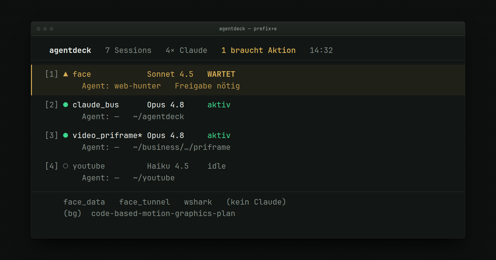
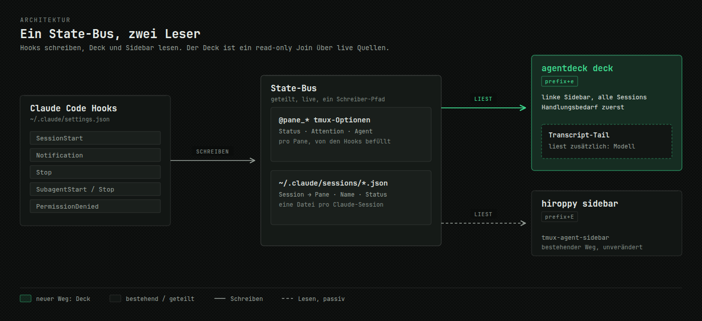
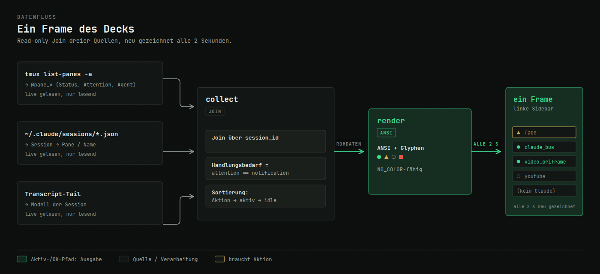

<div align="center">



# agentdeck

### Ein Blick, und du weißt: welche tmux-Session, wo läuft Claude, wo ist Handlungsbedarf.

**Session-gruppierter Agenten-Überblick · gewohnte Geste (prefix + e) · read-only · null Lock-in**


</div>

---

## Über das Projekt

Wer mit **mehreren tmux-Sessions** arbeitet — in jeder eine Claude-Code-Instanz, jede an etwas
anderem — verliert schnell den Überblick: *In welcher Session läuft gerade was? Welche wartet auf
meine Freigabe?* [hiroppys](https://github.com/hiroppy/tmux-agent-sidebar) exzellente
`tmux-agent-sidebar` zeigt jeden Agenten-Pane live, gruppiert aber **nach Git-Repo** — nicht nach
deinen benannten Sessions.

**agentdeck setzt genau hier an.** Es ist **kein Fork** und **kein Re-Upload** dieses Tools, sondern:

- ein eigener **Deck** — eine toggelbare linke Sidebar (dieselbe Geste wie bisher, `prefix + e`), die
  **nach tmux-Session gruppiert** und **Handlungsbedarf zuerst** zeigt;
- die bewährte **Integrationsschicht** drumherum: additiver Ein-Befehl-Installer, saubere
  Config-Snippets, ein verifizierter Statusline- und ein Remote-Notification-Baustein, ehrliche
  Betriebsdoku und ein chirurgischer Rückbau — zugeschnitten auf **headless-VPS/SSH**.

Der Deck **sammelt keine neuen Daten**: er liest nur zusammen, was ohnehin schon live anfällt
(tmux-Pane-Optionen, Claude-Session-Dateien, Transcript) — read-only, ohne Dauerprozess.
hiroppys Detail-Sidebar bleibt vollständig erhalten, nur eine Taste weiter (`prefix + E`).

> **Inhalt:** [Highlights](#highlights) · [Der Deck](#der-deck-prefix--e) · [Wie es funktioniert](#wie-es-funktioniert)
> · [Bedienung](#bedienung) · [Installation](#installation) · [Konfiguration](#konfiguration)
> · [Headless-Realität](#headless-realität-ehrlich) · [Rückbau](#rückbau) · [Projektstruktur](#projektstruktur)
> · [Danke · Upstream](#danke--upstream)

---

## Highlights

- **Session-Überblick auf einen Blick.** Alle tmux-Sessions, gruppiert nach *deinen* Namen. Jede
  Claude-Instanz mit Modell, aktivem Agent und Status; Sessions ohne Claude gedimmt, Hintergrund als `(bg)`.
- **Handlungsbedarf zuerst.** Wartet eine Instanz auf dich (Freigabe/Eingabe) oder ist sie auf Fehler
  gelaufen, steht sie oben — amber bzw. rot markiert. Kein Scrollen, kein Suchen.
- **Gewohnte Geste.** Auf-/zuklappen wie immer: `prefix + e`. hiroppys Detail-Sidebar liegt auf `prefix + E`.
- **Read-only & ohne Daemon.** Ein Frame = ein Join aus drei bereits laufenden Quellen. Der
  Refresh-Loop lebt nur, solange die Sidebar offen ist, und beendet sich beim Schließen von selbst.
- **Sicher im Umgang mit Panes.** Geschlossen wird ausschließlich der eigene, markierte Deck-Pane —
  nie ein Arbeits- oder hiroppy-Pane.
- **Enterprise-Optik, emoji-frei.** Geometrische Statusglyphen (`● ▲ ○ ■`), gedämpfte Farben als
  Funktion, nicht als Deko. `NO_COLOR` und Nicht-TTY werden respektiert.
- **Additiv & rückbaubar.** Der Installer fasst nichts an, ohne vorher ein `.bak-<Zeitstempel>` zu
  schreiben; `uninstall.sh` entfernt per Sentinel genau das Hinzugefügte.

---

## Der Deck (prefix + e)

<div align="center">

</div>

Jede Zeile ist eine Claude-Instanz in ihrer tmux-Session:

| Element | Bedeutung |
|---|---|
| `▲` amber + `WARTET` | **Handlungsbedarf** — wartet auf Eingabe/Freigabe; Grund rechts daneben |
| `■` rot + `FEHLER` | Lauf abgebrochen / Fehlerzustand |
| `●` grün + `aktiv` | arbeitet gerade |
| `○` gedimmt + `idle` | bereit, nichts zu tun |
| `*` hinter dem Namen | die Session, an der dein tmux-Client gerade hängt |
| `Agent: …` | aktiver Subagent (aus `@pane_subagents`), sonst `—` |
| Modell | aufgelöst aus dem Transcript (z. B. `Opus 4.8`), sonst `—` |

Die Kopfzeile fasst zusammen: `N Sessions · M× Claude · K braucht Aktion`. Zum Pane einer Session
springen: `agentdeck jump <nummer|session>`.

---

## Wie es funktioniert

agentdeck forkt hiroppys Rust-Tool **nicht**. Es liest denselben Zustand, den die Claude-Hooks ohnehin
schon in tmux-Pane-Optionen schreiben, und verbindet ihn mit den Session-Dateien von Claude Code.

<div align="center">

<br><sub><a href="docs/readme/architecture.svg">↗ als SVG</a></sub>
</div>

Ein einzelner Frame entsteht als read-only Join dreier Quellen — in deutlich unter einer Zehntelsekunde:

<div align="center">

<br><sub><a href="docs/readme/dataflow.svg">↗ als SVG</a></sub>
</div>

| Schritt | Was passiert | Code |
|---|---|---|
| **collect** | Ein `tmux list-panes -a` holt Topologie + alle `@pane_*` in einem Aufruf; Join über `@pane_session_id` mit `~/.claude/sessions/*.json`; Modell aus dem Transcript-Tail; Handlungsbedarf = `@pane_attention == "notification"`. | `extras/deck/lib-collect.sh` |
| **render** | Zeilen → ANSI-Frame mit Glyphen; respektiert `NO_COLOR`/Nicht-TTY. Keine tmux-Aufrufe, keine Datei-Reads — rein und testbar. | `extras/deck/lib-render.sh` |
| **toggle** | Linker Pane auf/zu wie hiroppys Sidebar; schließt nur den eigenen Marker-Pane; der Loop beendet sich, sobald sein Pane verschwindet. | `bin/agentdeck` |

Die Trennung **Daten · Darstellung · Steuerung** ist Absicht: nur so lassen sich Collect und Render
mit Fixtures testen, ohne tmux anzufassen.

---

## Bedienung

Präfix = `Ctrl+b`.

| Taste | Wirkung |
|---|---|
| `prefix + e` | **agentdeck-Deck** (Session-Überblick, Handlungsbedarf zuerst) an/aus |
| `prefix + E` | **hiroppy-Detail-Sidebar** (Subagent-Tree, Git-Tab, Worktrees) an/aus |
| `prefix + Alt+e` | hiroppy-Sidebar in **allen** Fenstern an/aus |

Innerhalb der hiroppy-Sidebar (fokussieren mit `Ctrl+b ←`): `j`/`k` wählen, `Enter` springt zum Pane,
`Tab` filtert nach Status, `Shift+Tab` schaltet das Activity-/Git-Panel um. Vollständig in
[`docs/KEYBINDS.md`](docs/KEYBINDS.md).

---

## Installation

Voraussetzungen: `tmux` 3.0+, `git`, `jq`. Zum Bauen der Sidebar aus Quelle optional `cargo`.

```bash
git clone https://github.com/NEO849/agentdeck
cd agentdeck
./install.sh                 # Sidebar + tmux-Config + Deck-Binds + die Claude-Hooks
./install.sh --with-ntfy     # zusätzlich Remote-Push aufs Handy (Notification/Stop → ntfy)
./install.sh --with-statusline  # zusätzlich die agentdeck-Statusline
```

Danach `tmux source ~/.tmux.conf` und eine **neue** Claude-Session starten (Hooks greifen erst für
neue Sessions). Der Installer ist additiv und legt vor jeder Änderung an `~/.tmux.conf` und
`~/.claude/settings.json` ein `.bak-<Zeitstempel>` an; `~/.claude.json` wird nie berührt.

---

## Konfiguration

tmux-Optionen (im Config-Snippet gesetzt, jederzeit per `tmux set -g` überschreibbar):

| Option | Default | Wirkung |
|---|---|---|
| `@deck_width` | `27%` | Breite des Deck-Panes (schmaler Client/Handy → automatisch `30%`) |
| `@deck_interval` | `2` | Refresh-Intervall des Decks in Sekunden |
| `@sidebar_key` | `E` | Taste für hiroppys Einzel-Fenster-Toggle (von `e` auf `E` verlegt) |
| `@sidebar_key_all` | `M-e` | hiroppys Alle-Fenster-Toggle |

Der Deck respektiert `NO_COLOR` (dann reiner Text ohne ANSI). Remote-Notifications (ntfy/Pushover/
Telegram) sind in [`extras/NOTIFY_BACKENDS.md`](extras/NOTIFY_BACKENDS.md) beschrieben; Tokens gehören
nie ins Repo.

---

## Headless-Realität (ehrlich)

- **Desktop-Notifications von hiroppys Sidebar feuern auf reinem SSH/VPS nicht.** Das Plugin nutzt
  unter Linux `notify-send`; fehlt der Daemon/DBus, schaltet es die Funktion still ab. Dafür gibt es
  das ntfy-Add-on (`extras/notify-ntfy.sh`): Push aufs Handy per ausgehendem HTTPS, ganz ohne Desktop.
- **Speicherwachstum (offener Upstream-Bug #85).** Bei sehr lang laufendem tmux-Server kann der
  Server-Speicher mit aktiver **hiroppy-Sidebar** über Tage anwachsen. Der agentdeck-Deck ist davon
  nicht betroffen (kein Dauerprozess — er läuft nur, solange er offen ist). Workaround für die
  hiroppy-Sidebar bis zum Upstream-Fix: tmux-Server periodisch neu starten. Quelle:
  github.com/hiroppy/tmux-agent-sidebar/issues/85
- **Volle Feature-Tiefe** (Subagent-Tree, Task-Progress, Wait-Reason) nur mit **Claude Code**;
  Codex/OpenCode werden eingeschränkter unterstützt.

---

## Rückbau

```bash
./uninstall.sh          # entfernt chirurgisch nur agentdeck-/Sidebar-Einträge, fragt vor dem Löschen
./uninstall.sh --yes    # ohne Rückfrage
```

Entfernt die Deck-Binds (per Sentinel), rebindet hiroppy zurück auf `e`, nimmt die Statusline nur
zurück, wenn sie auf unser Script zeigt, und entfernt den tmux.conf-Block — jeweils mit vorherigem
Backup. Details in [`docs/ROLLBACK.md`](docs/ROLLBACK.md).

---

## Projektstruktur

```
agentdeck/
├── bin/agentdeck              # Dispatcher: deck | toggle | jump
├── extras/
│   ├── deck/
│   │   ├── lib-collect.sh     # reine Datenschicht (Join der drei Quellen)
│   │   ├── lib-render.sh      # reine Renderschicht (ANSI/Glyphen, NO_COLOR)
│   │   └── model-map.sh       # Modell-ID → Klarname
│   ├── notify-ntfy.sh         # Remote-Push (fail-closed)
│   ├── statusline.sh          # Claude-Code-Statusline (Modell·Dir·Branch·Kontext·Kosten)
│   └── sidebar-adaptive-width.sh
├── config/
│   ├── tmux.conf.snippet      # additive tmux-Verdrahtung (Binds + Optionen)
│   └── claude-hooks.snippet.json
├── docs/                      # RUNBOOK · ROLLBACK · KEYBINDS · readme/
├── install.sh · uninstall.sh  # additiv + rückbaubar (Backups, Sentinel)
└── LICENSE                    # MIT
```

---

## Danke · Upstream

Der Live-Zustand, den der Deck liest, stammt aus [hiroppys](https://github.com/hiroppy)
[`tmux-agent-sidebar`](https://github.com/hiroppy/tmux-agent-sidebar) (Rust, MIT) — ein hervorragendes
Tool, das agentdeck ergänzt, nicht ersetzt. Alle Marken und Rechte an der Sidebar liegen bei hiroppy.

---

<div align="center">
<sub>Gebaut für den Alltag mit vielen parallelen Claude-Code-Sessions. MIT-Lizenz.</sub>
</div>
